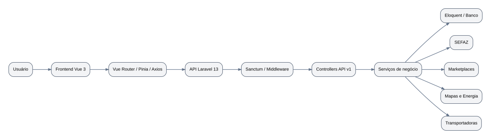

# Arquitetura

## Visão lógica

O sistema utiliza uma arquitetura web desacoplada:

1. O usuário acessa o frontend Vue.
2. Vue Router organiza navegação e guardas.
3. Pinia mantém estado de autenticação e dashboard.
4. Axios chama a API Laravel.
5. Laravel aplica rotas, middleware, validação e regras de negócio.
6. Models Eloquent persistem dados.
7. Serviços externos atendem SEFAZ, marketplaces, mapas, CNPJ e transportadoras.

## Backend

Pastas centrais:

- `app/Http/Controllers/Api/V1`: endpoints organizados por domínio.
- `app/Models`: entidades Eloquent.
- `routes/api.php`: rotas principais da API.
- `routes/marketplace_tecnicos.php`: rotas do núcleo de marketplace técnico.
- `database/migrations`: esquema evolutivo.
- `config`: configuração Laravel e integrações.
- `storage`: logs, cache e arquivos gerados.

## Frontend

Pastas centrais:

- `src/views`: telas por domínio.
- `src/components`: componentes reutilizáveis.
- `src/router/index.js`: rotas do SPA.
- `src/stores`: estado Pinia.
- `src/services`: cliente HTTP e integrações.
- `src/assets`: estilos globais.

## Domínios encontrados

Autenticação, cadastros, comercial, compras, CRM, dashboard, energia, estoque, expedição, financeiro, fiscal, integração, logística, marketplace, OS, PDV, plataforma e utilitários.
