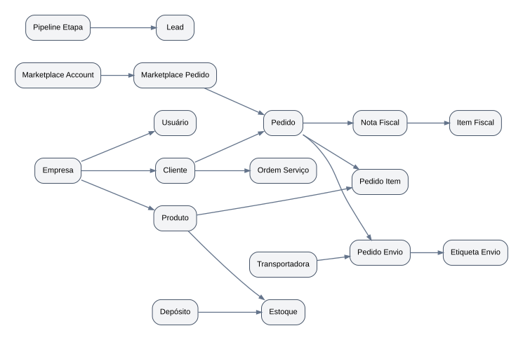

# Banco de dados

O esquema é mantido por migrations Laravel. O checkpoint contém migrations-base de 2025 e ampliações realizadas em julho de 2026.

## Grupos de entidades

| Domínio | Entidades principais |
|---|---|
| Identidade | empresas, usuarios, perfis, permissoes, social_accounts |
| Cadastros | clientes, fornecedores, produtos, categorias, marcas, unidades |
| Comercial | pedidos, pedido_itens, recibos, tabelas_preco |
| Compras | pedidos_compra, pedido_compra_itens |
| Estoque | depositos, estoques, movimentacoes, inventarios |
| Fiscal | notas_fiscais, itens, certificados, séries, CSC, cartas e devoluções |
| PDV | vendas, pagamentos e documentos NFC-e |
| CRM | leads, pipelines, etapas, reuniões e usinas ONS |
| Marketplace | contas, conectores, produtos, pedidos, processamento e fiscal |
| Logística | pedidos_envio, etiquetas_envio, transportadoras |
| OS | ordens, peças, fotos, histórico e status |
| Financeiro | contas a pagar/receber, contas bancárias, caixa e plano de contas |

## Regras de manutenção

- Nunca edite migrations já aplicadas em produção.
- Crie uma nova migration para cada alteração.
- Faça backup antes de `migrate`.
- Teste migrações em cópia do banco.
- Use foreign keys e índices em campos de relacionamento e busca.

## Auditoria recomendada

Antes da produção, gerar um dicionário automatizado a partir do banco final, pois nomes de tabelas e colunas podem ter evoluído entre migrations.
