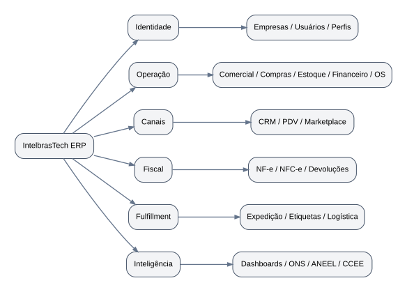

# Módulos

## Cadastros
Empresas, clientes, fornecedores, produtos, categorias, marcas, unidades e tabelas de preço.

## Comercial e compras
Pedidos de venda, Kanban, recibos, compras e itens.

## Estoque
Saldos por depósito, movimentos, inventários e entrada por XML.

## Financeiro
Contas a pagar, contas a receber, fluxo de caixa, contas bancárias, caixa e DRE.

## Fiscal
NF-e, NFC-e, configurações, certificado, CSC, numeração, DANFE, cancelamentos e devoluções.

## CRM
Leads, pipelines, prospecção por CNPJ e mapas, reuniões e oportunidades de energia.

## Marketplace
Contas, conectores, catálogo, pedidos, fiscal, automações e dropshipping Nuvemshop.

## Expedição e logística
Separação, despacho, etiquetas, transportadoras e acompanhamento.

## Ordem de serviço
Cadastro, status, peças, fotos e histórico.

