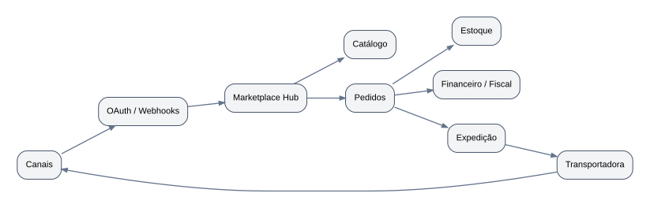
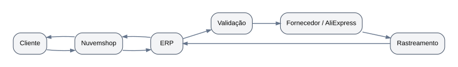

# Marketplace

O checkpoint possui estrutura para hub multicanal, contas OAuth, catálogo, pedidos, processamento financeiro/fiscal e automações.

## Canais identificados

- Mercado Livre
- Shopee
- Nuvemshop
- Estrutura genérica de conectores para expansão

## Fluxos

- Conectar conta e armazenar tokens de forma protegida.
- Importar/sincronizar catálogo.
- Receber pedidos.
- Reservar/baixar estoque.
- Processar financeiro e fiscal.
- Encaminhar para expedição.
- Sincronizar status e rastreamento.

## Dropshipping Nuvemshop

O checkpoint inclui migration e tela específicas para fluxo Nuvemshop/dropshipping. A automação completa depende das credenciais e contratos das APIs envolvidas.

