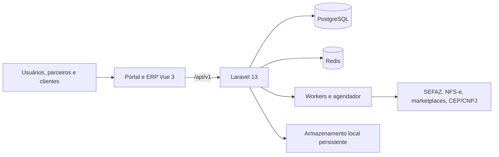

# IntelbrasTech ERP

> Plataforma integrada para operação comercial, fiscal, técnica, logística e de relacionamento da IntelbrasTech.

O IntelbrasTech ERP reúne o portal institucional e o ambiente operacional da empresa em uma única plataforma. O projeto usa uma API Laravel, uma aplicação Vue 3 e serviços de suporte para persistência, filas, cache e mensageria.

[](https://laravel.com)
[](https://vuejs.org)
[](https://www.postgresql.org)
[](LICENSE)

## O que a plataforma atende

| Área | Capacidades principais |
| --- | --- |
| Portal | Site institucional, simulador solar, solicitação de técnico, cadastro de parceiros, SEO e rastreamento. |
| CRM | Leads, pipelines, Kanban, atividades, metas, automações, propostas e distribuição comercial. |
| Comercial e estoque | Clientes, fornecedores, catálogo, preços, compras, pedidos, depósitos e inventário. |
| PDV | Abertura/fechamento de caixa, vendas, pagamentos, NFC-e/NF-e e histórico. |
| Fiscal | NF-e, NFC-e, DANFE, certificado A1, CSC, sequencial, contingências e integração SEFAZ. |
| Serviços | Ordens de serviço, visitas, equipe técnica, disponibilidade, geolocalização e distribuição de demandas. |
| Inteligência territorial | Mapas ONS, ANEEL e CCEE para pesquisa e geração de oportunidades. |
| Integrações | Mercado Livre, Shopee, Nuvemshop, CEP/IBGE, CNPJ, e-mail marketing e ferramentas analíticas. |

## Arquitetura em um minuto



## Comece pela documentação

- [Índice da documentação](docs/README.md)
- [Arquitetura e fluxos](docs/architecture.md)
- [Instalação e ambiente local](docs/getting-started.md)
- [Módulos e jornadas de negócio](docs/modules.md)
- [Fiscal e NFS-e](docs/fiscal.md)
- [Operação em produção](docs/operations.md)
- [API e integrações](docs/api.md)

> A pasta [`Documentação/`](Documentação/README.md) contém material histórico produzido durante as fases iniciais. Para implantação, operação e evolução, utilize os documentos em [`docs/`](docs/README.md).

## Execução local resumida

Pré-requisitos: Docker Desktop/Engine, Docker Compose v2, Git e, para execução sem Docker, PHP 8.3+ e Node.js 20+.

```bash
git clone git@github.com:StartGameCreator/IntelbrasTech-ERP.git
cd IntelbrasTech-ERP
cp backend/.env.example backend/.env

# Ajuste backend/.env antes de continuar.
cd docker
docker compose --env-file ../backend/.env up -d --build
```

Com a pilha de desenvolvimento em execução, o front-end fica em `http://localhost:5173`. Consulte o guia completo antes de configurar fiscal, e-mail, integrações ou dados reais.

## Princípios de segurança

- Nunca versione `.env`, certificados A1/PFX, CSC, senhas, tokens OAuth ou backups de banco.
- Produção usa PostgreSQL e armazenamento persistente local; SQLite e driver fiscal simulado são somente opções de desenvolvimento.
- Emissão fiscal real deve permanecer desabilitada até a validação de certificado, CSC, séries, numeração e ambiente da SEFAZ.
- Faça backup testado antes de migrations, atualização de containers ou alteração de configuração fiscal.

## Licença

Código proprietário. Consulte [LICENSE](LICENSE).
