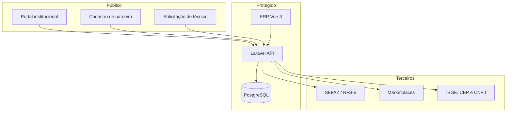

# Documentação IntelbrasTech ERP

Esta é a referência operacional e técnica do repositório. Os documentos são mantidos em português e descrevem o estado arquitetural atual do projeto, não apenas uma visão de produto.

## Roteiro de leitura

| Para quem | Comece por | Depois siga para |
| --- | --- | --- |
| Administrador | [Operação em produção](operations.md) | [Fiscal](fiscal.md) e [API](api.md) |
| Desenvolvedor | [Arquitetura](architecture.md) | [Instalação](getting-started.md) e [API](api.md) |
| Produto/negócio | [Módulos](modules.md) | [Arquitetura](architecture.md) |
| Operação fiscal | [Fiscal e NFS-e](fiscal.md) | [Operação em produção](operations.md) |

## Documentos

1. [Arquitetura e fluxos](architecture.md) — componentes, fronteiras, dados e processamento assíncrono.
2. [Instalação e desenvolvimento](getting-started.md) — ambiente local, configuração e validação.
3. [Módulos e jornadas](modules.md) — responsabilidades funcionais e fluxos entre áreas.
4. [Fiscal e NFS-e](fiscal.md) — pré-requisitos, emissão, contingências e limites de responsabilidade.
5. [Operação em produção](operations.md) — Docker, backup, observabilidade, deploy e recuperação.
6. [API e integrações](api.md) — autenticação, convenções, endpoints e provedores externos.

## Convenções adotadas

- Diagramas usam [Mermaid](https://mermaid.js.org) e são renderizados diretamente pelo GitHub.
- Exemplos usam valores fictícios: substitua-os por valores do seu ambiente.
- Variáveis, chaves, certificados, CSC e tokens são sempre tratados como segredos e não devem aparecer em issues, commits ou capturas de tela.
- Recursos dependentes de credenciais ou homologação são identificados como **configuráveis**, não como automaticamente disponíveis.

## Visão geral das fronteiras

## Histórico

Os arquivos em [`../Documentação/`](../Documentação/README.md) foram preservados por conterem registros úteis de etapas anteriores. Eles não substituem a documentação atual desta pasta.
