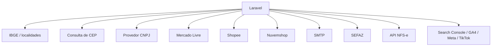
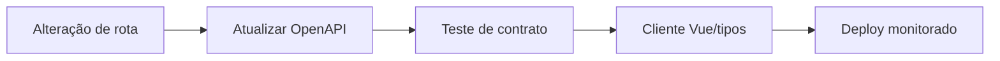

# API e integrações

## Convenções da API

- Prefixo principal: `/api/v1`.
- Formato: JSON, salvo downloads/uploads multipart.
- Autenticação: Laravel Sanctum para as rotas protegidas.
- Contexto: as rotas de negócio usam usuário autenticado e empresa ativa.
- Erros de validação: HTTP `422` com detalhes por campo.
- Não exponha detalhes de exceção ou segredos quando `APP_ENV=production`.

```mermaid
flowchart LR
  SPA[Vue / Portal] -->|JSON| API[/api/v1]
  API --> Auth[Sanctum + empresa]
  Auth --> Domain[Controladores e serviços]
  Domain --> DB[(PostgreSQL)]
  Domain --> Jobs[Fila]
  Jobs --> Providers[Provedores externos]
```

## Autenticação

| Ação | Método e rota | Observação |
| --- | --- | --- |
| Login | `POST /api/v1/auth/login` | Retorna contexto de usuário após validar credenciais. |
| Logout | `POST /api/v1/auth/logout` | Exige autenticação. |
| Perfil atual | `GET /api/v1/auth/me` | Usado para inicializar a sessão do front-end. |
| Alterar perfil | `PUT /api/v1/auth/perfil` | Exige usuário autenticado. |
| Alterar senha | `PUT /api/v1/auth/senha` | Requer validação de segurança. |

Exemplo conceitual de uma chamada autenticada:

```http
GET /api/v1/auth/me HTTP/1.1
Accept: application/json
Authorization: Bearer <token-ou-sessão-Sanctum>
```

Não coloque token em URL, log de browser, captura de tela ou repositório.

## Rotas públicas relevantes

| Rota | Objetivo |
| --- | --- |
| `GET /api/v1/portal/configuracao` | Configuração pública do portal. |
| `GET /api/v1/portal/catalogo` | Catálogo exibido no site. |
| `GET /api/v1/portal/carrossel` | Conteúdo público do carrossel. |
| `GET /api/v1/localidades/ufs` | Lista de UFs. |
| `GET /api/v1/localidades/ufs/{uf}/municipios` | Municípios por UF. |
| `GET /api/v1/cep/{cep}` | Consulta/normalização de CEP. |
| `POST /api/v1/portal/solicitacoes` | Captação pública limitada por throttle. |
| `POST /api/v1/platform/cadastros/{tipo}` | Cadastro público de perfil permitido. |

Rotas públicas devem aplicar validação, limite de requisições, proteção contra abuso e registro de origem. Não trate dados recebidos do navegador como confiáveis.

## Gestão técnica

| Rota | Método | Função |
| --- | --- | --- |
| `/api/v1/gestao-equipe` | `GET` | Resumo da equipe, demandas e vendedores pendentes. |
| `/api/v1/gestao-equipe/demandas/{origem}/{id}/atribuir` | `PATCH` | Atribui ou remove responsável de OS/visita. |
| `/api/v1/tecnico/operacao` | `GET` | Painel operacional do técnico autenticado. |
| `/api/v1/tecnico/operacao/disponibilidade` | `PATCH` | Atualiza disponibilidade do técnico. |
| `/api/v1/tecnico/operacao/localizacao` | `PATCH` | Atualiza localização consentida. |
| `/api/v1/tecnico/operacao/oportunidades/{origem}/{id}/aceitar` | `POST` | Aceita uma oportunidade elegível. |
| `/api/v1/platform/cadastros/mapa-tecnicos` | `GET` | Pontos e rankings para o mapa da equipe. |

### Segurança de geolocalização

Localização precisa de consentimento explícito do dispositivo, autenticação, visibilidade somente para perfis autorizados e política de retenção. O endpoint não deve aceitar localização para outro usuário enviada por um gestor sem trilha de auditoria.

## CRM e portal

| Área | Recursos de API |
| --- | --- |
| CRM | Leads Kanban, mudança de etapa, ganho/perda, timeline, atividades, produtos, metas e automações. |
| Portal | Configuração de conteúdo, carrossel, solicitações, simulação solar e rastreamento administrável. |
| E-mail | Configuração, contatos, modelos, campanhas, enfileiramento e processamento. |
| CNPJ | Fontes configuradas, consulta, lote e importação de lead. |

## Comercial, estoque e fiscal

O arquivo `backend/routes/api.php` é a referência definitiva das rotas disponíveis. A documentação de endpoint deve ser atualizada junto com qualquer mudança de contrato.

Principais famílias existentes:

- `clientes`, `fornecedores`, `produtos`, `categorias`, `marcas`, `depositos`;
- `compras`, `pedidos`, `estoque`, `inventarios`;
- `pdv`, `vendas`, `financeiro`;
- `nfe`, `nfce`, configurações fiscais e certificado;
- `os`, assistência técnica, expedição e transportadoras;
- `marketplaces`, Mercado Livre, Shopee e Nuvemshop;
- `mapa-ons`, `mapa-aneel` e `mapa-ccee`.

Para rotas fiscais, consulte também [Fiscal e NFS-e](fiscal.md). Elas exigem validações adicionais e não devem receber dados de teste em produção.

## Provedores externos



### Política para integrações

1. Armazene segredo apenas no ambiente seguro ou cofre dedicado.
2. Mantenha callback/redirect URI exato para OAuth.
3. Teste conexão com uma conta controlada antes de sincronizar produção.
4. Trate limites de API, expiração de token e retentativas idempotentes.
5. Registre resultado, correlação e erro sanitizado para suporte.
6. Não grave payloads que contenham senha, token completo ou dados desnecessários.

## CORS, domínio e PWA

Quando o domínio mudar, revise em conjunto:

- `APP_URL` e `FRONTEND_URL`;
- origens permitidas por CORS;
- `SANCTUM_STATEFUL_DOMAINS`;
- URL pública da API usada pelo build (`VITE_API_URL`);
- manifesto, service worker, ícones e escopo do PWA;
- callbacks OAuth dos marketplaces e provedores de login.

Uma página que renderiza mas exibe “sem conexão com o servidor” normalmente indica divergência entre URL do front-end, proxy `/api`, CORS, cookie ou domínio stateful — não apenas um problema visual.

## Evolução para OpenAPI

Ainda não há um contrato OpenAPI versionado como fonte oficial. A evolução recomendada é:



Até essa adoção, revise `backend/routes/api.php`, validações do controller e chamadas em `frontend/src/services/` sempre em conjunto.
