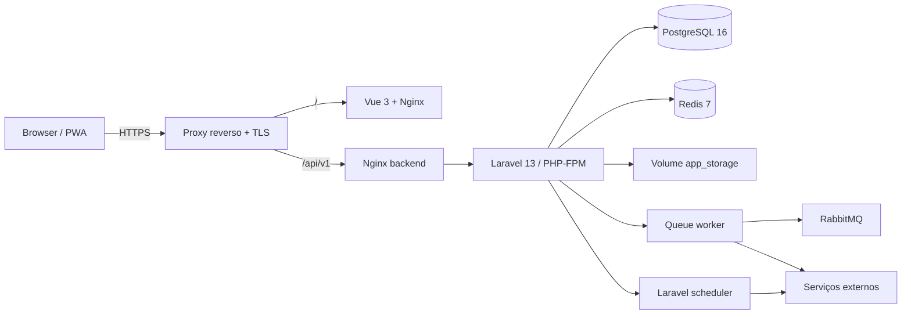
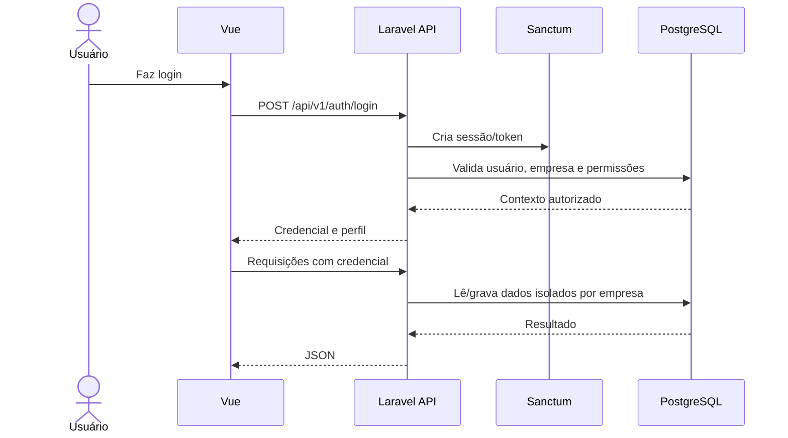
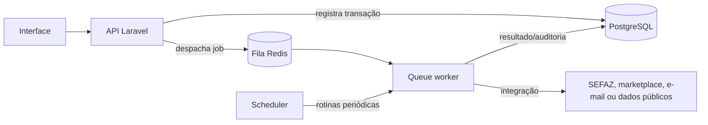
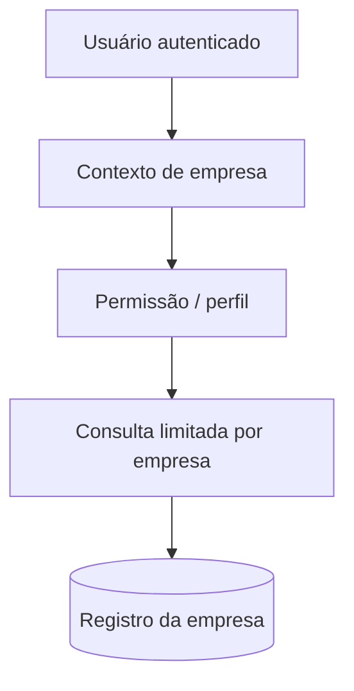

# Arquitetura e fluxos

## Visão de componentes

O sistema é formado por um front-end SPA, uma API REST e serviços de infraestrutura executados em containers. Em produção, os containers não expõem banco, Redis ou filas para a Internet: a publicação externa deve ocorrer por um proxy reverso com TLS.



### Responsabilidades

| Componente | Responsabilidade |
| --- | --- |
| Vue 3 + Vite | Interface do ERP, portal institucional, PWA, mapas e experiência mobile. |
| Nginx front-end | Publica os artefatos estáticos gerados pelo Vite. |
| Nginx backend | Encaminha chamadas PHP para o Laravel/PHP-FPM. |
| Laravel 13 | Regras de negócio, autenticação, autorização, API REST, jobs, integrações e arquivos. |
| PostgreSQL | Fonte de verdade transacional em produção. |
| Redis | Cache, sessão e fila configuráveis pelo ambiente. |
| Queue/Scheduler | Processos independentes para trabalhos demorados e tarefas agendadas. |
| RabbitMQ | Mensageria disponível para integrações assíncronas. |
| Volume `app_storage` | Arquivos gerados e uploads que devem sobreviver à recriação dos containers. |

## Organização do repositório

```text
IntelbrasTech-ERP/
├── backend/                 # Laravel: domínio, API, migrations e jobs
├── frontend/                # Vue 3: portal e ERP
├── docker/                  # Compose e imagens de desenvolvimento/produção
├── sql/                     # Scripts auxiliares de banco
├── tools/windows-signer/    # Assinador local opcional para certificado do dispositivo
├── docs/                    # Documentação operacional atual
└── Documentação/            # Acervo histórico
```

## Fluxo de requisição autenticada



## Processamento assíncrono

Operações que podem demorar, depender de terceiros ou exigir repetição devem sair do ciclo HTTP. A API registra a intenção, a fila trata o trabalho e a interface consulta o resultado ou o status.



## Isolamento por empresa

Os recursos administrativos, comerciais, fiscais e técnicos pertencem a uma empresa. Controladores e consultas devem usar o contexto autenticado de empresa e nunca confiar em um `empresa_id` enviado livremente pelo navegador.



## Armazenamento de arquivos

Em produção, os arquivos ficam no volume persistente associado à aplicação quando `FILESYSTEM_DISK=local`. Isso inclui uploads, documentos gerados e artefatos fiscais. O volume faz parte do plano de backup; recriar containers sem preservar esse volume causa perda de arquivos.

Para ambientes que adotarem armazenamento compatível com S3, a troca deve ser feita por configuração e testada com upload, leitura autorizada e recuperação de backup. Não misture os dois discos sem política de migração.

## Decisões arquiteturais importantes

1. **SPA separada da API:** simplifica a experiência PWA e mantém o backend reutilizável por aplicativos futuros.
2. **PostgreSQL em produção:** garante concorrência, integridade e backup centralizado. SQLite é adequado apenas para desenvolvimento isolado.
3. **Containers com volumes persistentes:** banco, Redis, RabbitMQ e arquivos não devem viver no filesystem efêmero de uma imagem.
4. **Integrações sob configuração:** credenciais e URLs ficam fora do repositório; a interface administrativa referencia a configuração sem revelar segredos.
5. **Fiscal com bloqueios explícitos:** ambiente, driver, certificado, CSC, série e numeração precisam estar coerentes antes de qualquer transmissão.

## Pontos de extensão

- Novos provedores externos: controlador + serviço + configuração no banco/ambiente + teste isolado.
- Novas telas: rota protegida, permissão, chamada à API e comportamento responsivo.
- Trabalhos longos: Job idempotente, rastreável e com política de repetição.
- Novas emissões fiscais: modelo XML validado, sandbox/homologação, registro de retorno e contingência definida.
