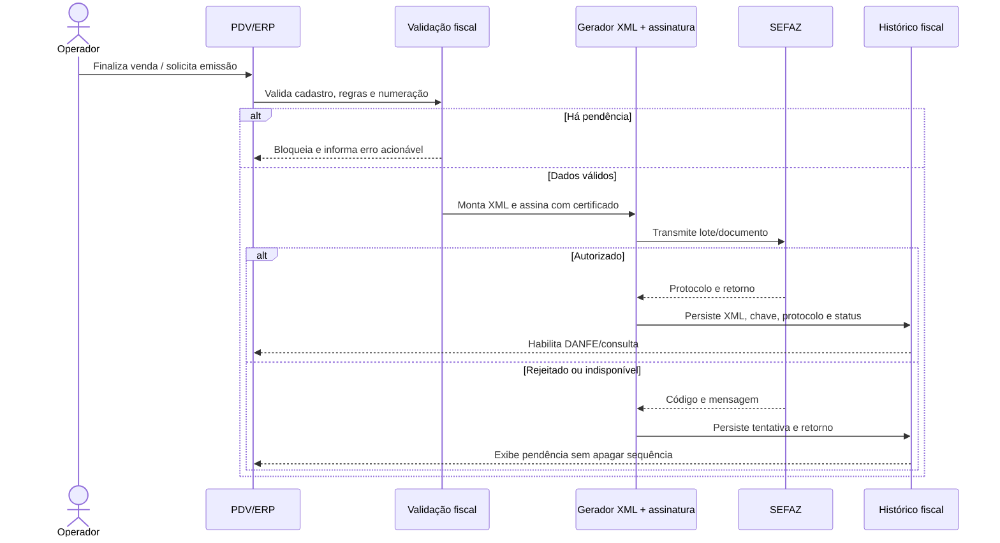
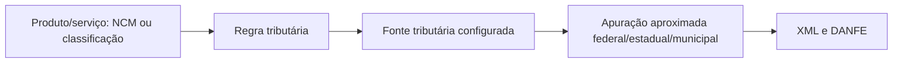

# Operação fiscal e NFS-e

> **Atenção:** este documento orienta a operação técnica do sistema; ele não substitui contador, legislação aplicável, credenciamento estadual/municipal ou validação jurídica. Não transmita documentos reais somente para testar a integração.

## Escopo fiscal

| Documento | Modelo/autoridade | Uso no ERP |
| --- | --- | --- |
| NF-e | Modelo 55 / SEFAZ | Operações com mercadorias, especialmente interestaduais ou quando a regra exigir. |
| NFC-e | Modelo 65 / SEFAZ | Venda ao consumidor no PDV, conforme regras da UF e do emitente. |
| NFS-e | Padrão nacional/município | Prestação de serviços, dependente de habilitação e credenciais próprias. |
| DANFE/DANFSe | Representação auxiliar | PDF/impressão após XML/documento autorizado ou conforme o fluxo aplicável. |

## Pré-requisitos para emissão real

Antes de liberar produção, valide todos os itens abaixo com o contador/responsável fiscal:

- Cadastro completo do emitente: CNPJ, IE/IM quando aplicável, CRT, endereço e código IBGE.
- Produtos/serviços com NCM, CFOP, unidade, origem, regras tributárias e classificação compatíveis.
- Destinatário com CPF/CNPJ, endereço e município IBGE quando exigido.
- Certificado digital A1 válido, armazenado de forma segura e vinculado à empresa correta.
- CSC e identificador CSC para NFC-e, cadastrados para o ambiente correto.
- Série e numeração inicial compatíveis com o controle fiscal existente.
- Ambiente SEFAZ correspondente: homologação (`2`) para testes ou produção (`1`) para documentos válidos.
- URLs de consulta e QR Code da UF configuradas de acordo com o manual vigente.
- Rotina de backup e auditoria ativa antes da primeira emissão.

## Configuração do ambiente

As variáveis abaixo são sensíveis ao ambiente. Os nomes podem constar no `.env`, mas os valores não devem ser publicados.

```dotenv
# Produção: exemplo de intenção, nunca copie segredos deste documento.
APP_ENV=production
APP_DEBUG=false
DB_CONNECTION=pgsql
FILESYSTEM_DISK=local

FISCAL_DRIVER=nfephp
SEFAZ_AMBIENTE=1
FISCAL_ALLOW_FAKE_IN_PRODUCTION=false
FISCAL_STORAGE_DISK=local

SEFAZ_NFCE_QRCODE_URL=https://endpoint-oficial-da-uf/exemplo
SEFAZ_NFCE_CONSULTA_URL=https://endpoint-oficial-da-uf/exemplo
SEFAZ_NFE_CONSULTA_URL=https://endpoint-oficial-da-uf/exemplo
```

### Significado operacional

| Variável | Efeito |
| --- | --- |
| `FISCAL_DRIVER` | Seleciona o driver fiscal. Em produção deve apontar para o driver real aprovado. |
| `SEFAZ_AMBIENTE` | `1` para produção; `2` para homologação. Não troque sem confirmar certificado, CSC e série. |
| `FISCAL_ALLOW_FAKE_IN_PRODUCTION` | Deve permanecer `false`. Impede emissão simulada em ambiente produtivo. |
| `FISCAL_STORAGE_DISK` | Local onde XML, PDF e retornos serão armazenados. Deve possuir backup. |
| URLs SEFAZ | Influenciam consulta e QR Code. Use endpoints oficiais da UF e versão de layout correta. |

## Fluxo de emissão



## Regras que não devem ser contornadas

1. **Numeração é imutável depois de reservada/transmitida.** Estorno de venda não autoriza voltar número. Registre o evento correto, rejeição, inutilização ou cancelamento conforme a situação.
2. **Autorização não é sinônimo de impressão.** Guarde XML, protocolo e chave; o DANFE é representação auxiliar.
3. **QR Code de NFC-e deve seguir o manual oficial.** Um QR Code que abre página com parâmetro ausente indica URL/parâmetros de consulta incorretos, não um problema visual do PDF.
4. **Rejeição SEFAZ é dado de negócio.** Preserve código, mensagem e XML para correção/auditoria.
5. **Não altere dados fiscais diretamente no banco.** Faça a correção pelo fluxo da aplicação e com orientação contábil.

## Diagnóstico seguro

| Sintoma | Causa provável | Ação segura |
| --- | --- | --- |
| Driver simulado bloqueado | Ambiente produção usando driver `fake` | Configure driver real e limpe cache da aplicação; não force a emissão. |
| Código IBGE do destinatário ausente | Cadastro/endereço incompleto | Corrija cidade/UF/IBGE no cliente e valide antes de retransmitir. |
| QR Code não abre consulta | URL/CSC/identificador/parâmetros incoerentes | Compare com o manual da UF e teste somente documento autorizado. |
| XML inválido | Grupo tributário incompatível, por exemplo CSOSN/CST | Corrija a regra tributária do item/empresa com contador. |
| Duplicidade de chave/número | Reuso de sequência ou transmissão anterior | Consulte o histórico e SEFAZ; não reduza número. |
| DANFE pede autenticação | Link aberto fora da sessão | Gere download autenticado no ERP ou use URL assinada/controlada. |

## Transparência tributária

O campo de transparência tributária deve ser alimentado por uma fonte tributária licenciada/configurada e pelas classificações corretas do item. Valores `0,00` não devem ser substituídos por estimativas manuais para “preencher o layout”.

Fluxo recomendado:



## NFS-e de serviços

A estrutura de NFS-e deve ficar pronta para receber credenciais, mas só deve transmitir após o emitente estar habilitado no ambiente do padrão nacional ou município competente.

Checklist adicional:

- Chave/API e credencial emitidas pela autoridade competente.
- Inscrição municipal e código de serviço conferidos.
- Município aderente ao fluxo adotado e ambiente escolhido.
- Retenções, ISS, deduções e tomador revisados pelo contador.
- Callback/consulta de status e armazenamento de XML/PDF testados em homologação quando disponível.

## Assinador local de certificado

Há suporte planejado para um assinador opcional do dispositivo, distribuído em `tools/windows-signer/`. Ele é complementar ao certificado A1 armazenado/configurado no ERP: não substitui o fluxo já validado. A comunicação deve exigir origem confiável, autorização do usuário e não pode expor chave privada ao navegador ou à API.

## Checklist antes de cada mudança fiscal

- [ ] Backup de banco e arquivos fiscalmente relevantes confirmado.
- [ ] Certificado dentro da validade e correspondente ao emitente.
- [ ] Ambiente (1/2), série, CSC e URL de consulta revisados.
- [ ] Alteração revisada em homologação quando aplicável.
- [ ] Histórico de emissão preservado.
- [ ] Contador/responsável fiscal ciente da alteração.
