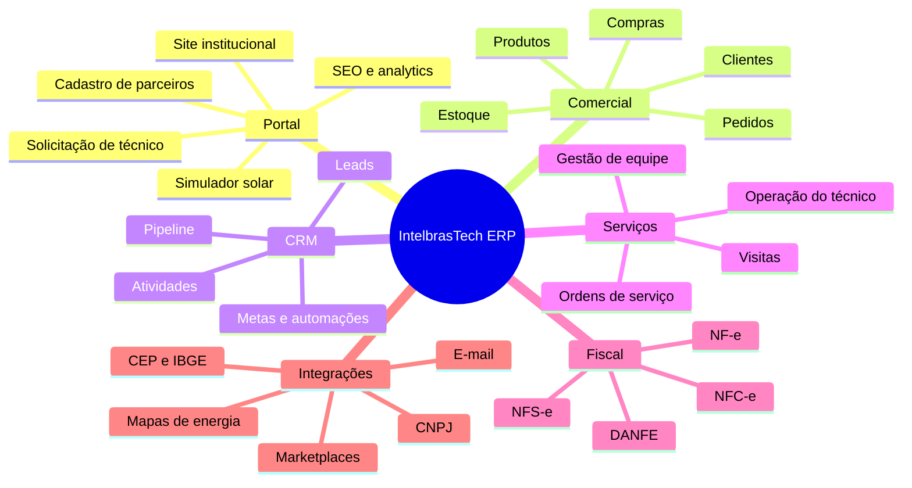
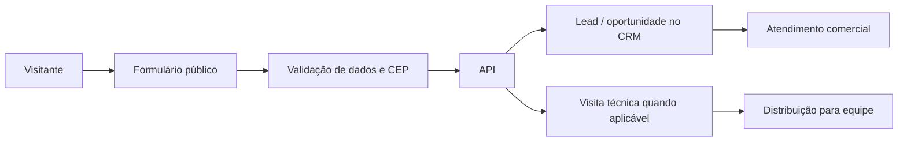
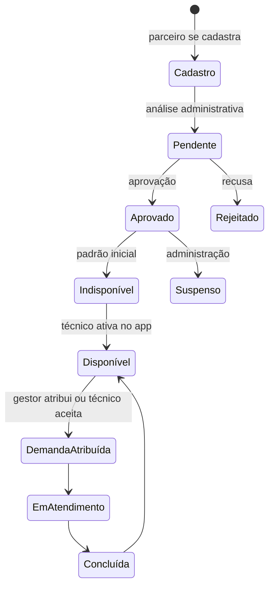
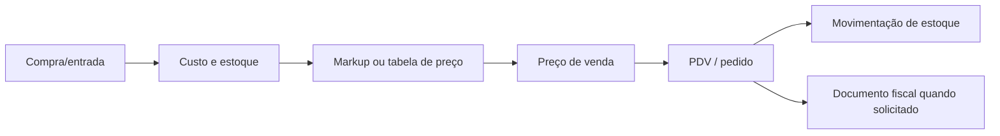

# Módulos e jornadas de negócio

## Mapa funcional

## Portal institucional

O portal é a porta pública da plataforma. Ele apresenta soluções, produtos e serviços, inclui carrosséis administráveis e captura oportunidades por simulador solar, solicitação de técnico e cadastro de parceiros.

### Regra de encaminhamento

Dados captados no portal não devem ficar em uma caixa de e-mail isolada. Eles são convertidos em registro operacional para acompanhamento no CRM ou na gestão técnica, mantendo origem, data e contexto da solicitação.

## CRM

O CRM é a fonte de trabalho dos vendedores depois de aprovados. Gestão de Equipe aprova o acesso inicial; a condução comercial — leads, tarefas, metas, motivos de perda, negociação e funil — acontece exclusivamente no CRM.

### Ciclo recomendado do lead

1. Capturar a origem: portal, indicação, CNPJ, mapa energético, importação ou cadastro manual.
2. Qualificar informações mínimas: empresa/pessoa, contato, cidade/UF, interesse e responsável.
3. Mover pelo pipeline conforme a atividade real, registrando contatos e próximos passos.
4. Associar produtos/serviços e valores quando houver proposta.
5. Marcar ganho ou perda com motivo, preservando histórico para análise.

## Gestão de equipe e operação técnica

Este é o centro único para administração de técnicos e distribuição de demandas. O antigo caminho de Marketplace de Técnicos redireciona para **Gestão de Equipe → Mapa e base técnica**.

| Aba | Uso |
| --- | --- |
| Demandas técnicas | Atribui visitas e ordens de serviço a técnicos/campo. |
| Técnicos | Exibe disponibilidade, cidade, contato, carga e última atualização de GPS. |
| Mapa e base técnica | Mapa de cobertura, ranking regional, filtros, perfil técnico, status e lixeira. |
| Aprovar vendedores | Dá aceite inicial; após aprovado, o vendedor atua no CRM. |

### Jornada do técnico

O aplicativo do técnico atualiza disponibilidade e localização consentida pelo navegador/dispositivo. A posição deve ser exibida apenas a usuários autorizados, usada para distribuição operacional e protegida por política de retenção.

## Produtos, compras e estoque

- **Compra** registra custo de aquisição e entrada.
- **Estoque** controla saldos e movimentações por depósito.
- **Preço de venda** é definido por tabela, markup ou ajuste manual; não deve sobrescrever o custo de compra.
- **PDV** mostra preço de compra para margem/controle quando o usuário tiver permissão e preço de venda como referência de atendimento.

## PDV e financeiro

O PDV exige caixa aberto, depósito selecionado, itens, cliente quando aplicável e forma de pagamento. A venda pode gerar um fluxo fiscal conforme o perfil escolhido; o documento fiscal possui ciclo próprio e não deve ser confundido com a confirmação financeira da venda.

O módulo financeiro consolida contas a pagar, contas a receber, fluxo de caixa e relatórios. Qualquer integração automática deve ser auditável e reversível por processo de negócio, não por alteração direta no banco.

## Fiscal

NF-e (modelo 55), NFC-e (modelo 65) e NFS-e têm regras, autoridades e configurações distintas. Consulte o [guia fiscal](fiscal.md) antes de ativar qualquer transmissão em produção.

## Energia e inteligência territorial

Os mapas ONS, ANEEL e CCEE são recursos de pesquisa e geração de oportunidades. Eles devem manter mapa, filtros e resultado em regiões previsíveis da tela — especialmente no mobile — para não sobrepor navegação ou bloquear interação.

## Integrações e marketing

| Integração | Objetivo | Dependência |
| --- | --- | --- |
| IBGE/CEP | UF, municípios, CEP e normalização de endereço | Serviço público/disponibilidade externa |
| Consulta CNPJ | Enriquecimento de cadastro e prospecção | Provedor configurado e limites de uso |
| Marketplaces | Catálogo, pedidos, estoque e fiscal | OAuth/API de cada canal |
| E-mail marketing | Contatos, modelos, campanhas e fila | SMTP e reputação de envio |
| Analytics | Search Console, GA4, Meta, TikTok e outros pixels | IDs, consentimento e política de privacidade |

O fato de uma integração existir na interface não significa que está ativa: ela depende de credenciais, escopo concedido, callback, testes e monitoramento.
