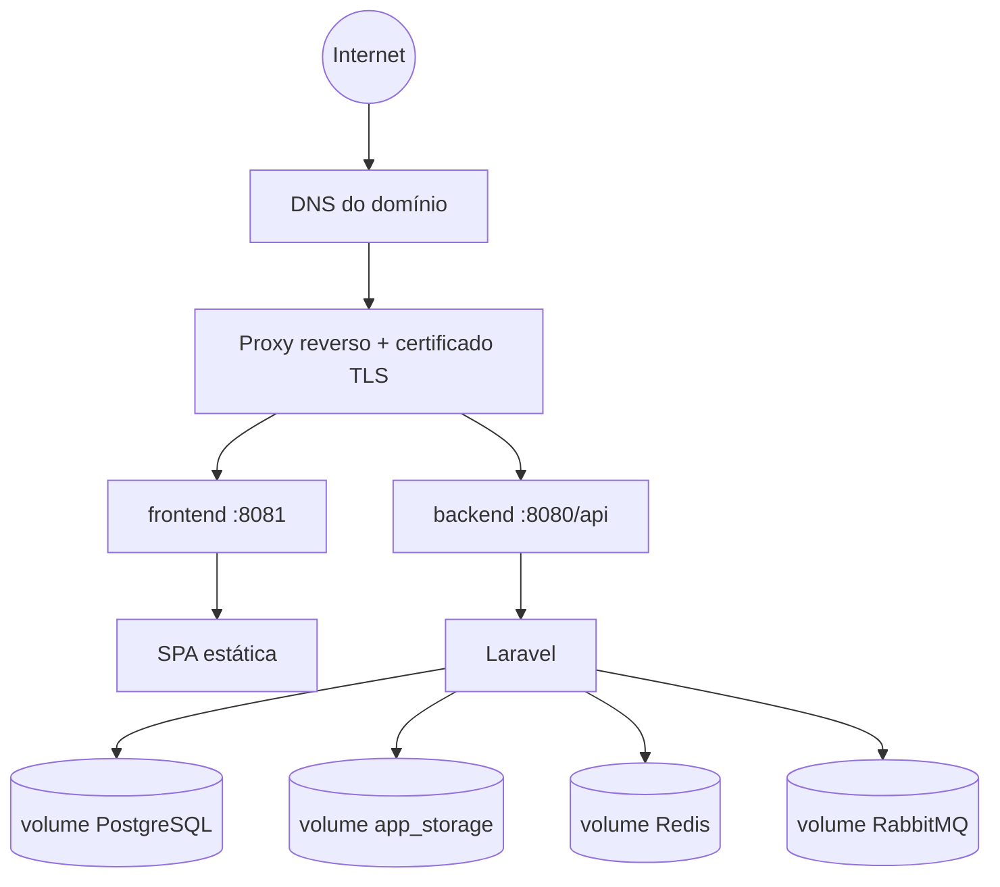
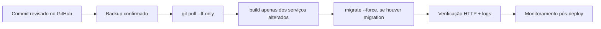
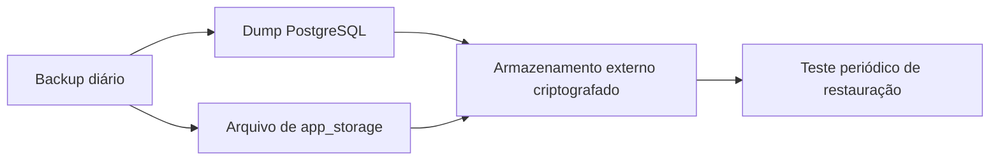

# Operação em produção

## Topologia de produção

O ambiente de produção usa Docker Compose. A aplicação é composta por serviços de front-end, backend, PHP/Laravel, fila, agendador, PostgreSQL, Redis, RabbitMQ e Mailpit. As portas de serviços internos são vinculadas a `127.0.0.1` no compose de produção; um proxy reverso no host deve fazer a terminação TLS e encaminhar o tráfego público.



## Primeira implantação

### 1. Preparar o servidor

- Debian atualizado, usuário administrativo protegido e acesso SSH por chave.
- Docker Engine e Docker Compose v2 instalados.
- Firewall liberando apenas SSH e HTTP/HTTPS necessários.
- DNS `A` do domínio apontando para a VPS antes de emitir TLS.
- Projeto clonado em um diretório operacional, por exemplo `/opt/IntelbrasTech-ERP`.

### 2. Criar o `.env` de produção

Parta de `backend/.env.example`, mas **não o use sem revisão**. Produção requer ao menos:

```dotenv
APP_ENV=production
APP_DEBUG=false
APP_URL=https://seu-dominio.example
FRONTEND_URL=https://seu-dominio.example

DB_CONNECTION=pgsql
DB_HOST=postgres
DB_PORT=5432
DB_DATABASE=nome-do-banco
DB_USERNAME=usuario-do-banco
DB_PASSWORD=senha-forte-e-unica

FILESYSTEM_DISK=local
CACHE_STORE=redis
SESSION_DRIVER=redis
QUEUE_CONNECTION=redis
REDIS_HOST=redis
REDIS_PASSWORD=senha-forte-e-unica
```

Gere `APP_KEY` com Laravel, nunca com valor compartilhado entre ambientes. Segredos devem ter permissões de leitura restritas no host.

### 3. Subir a pilha

```bash
cd /opt/IntelbrasTech-ERP/docker
docker compose --env-file ../backend/.env -f docker-compose.prod.yml up -d --build
docker compose --env-file ../backend/.env -f docker-compose.prod.yml ps
```

Em seguida, execute migrations de forma controlada:

```bash
docker compose --env-file ../backend/.env -f docker-compose.prod.yml exec app php artisan migrate --force
docker compose --env-file ../backend/.env -f docker-compose.prod.yml exec app php artisan optimize
```

> Leia as migrations antes de aplicar. Uma migration pode alterar dados e não é automaticamente reversível.

## Atualização de aplicação



Exemplo para uma alteração somente de interface:

```bash
cd /opt/IntelbrasTech-ERP
git pull --ff-only origin main
docker compose --env-file backend/.env -f docker/docker-compose.prod.yml build frontend
docker compose --env-file backend/.env -f docker/docker-compose.prod.yml up -d --no-deps frontend
```

Para backend, reconstrua `app`, `queue` e `scheduler` juntos quando a imagem PHP mudar. Não reinicie PostgreSQL, Redis ou RabbitMQ sem necessidade.

## Observabilidade e diagnóstico

| Objetivo | Comando |
| --- | --- |
| Estado dos serviços | `docker compose --env-file ../backend/.env -f docker-compose.prod.yml ps` |
| Logs da aplicação | `docker compose --env-file ../backend/.env -f docker-compose.prod.yml logs -f app backend` |
| Fila | `docker compose --env-file ../backend/.env -f docker-compose.prod.yml logs -f queue` |
| Agendador | `docker compose --env-file ../backend/.env -f docker-compose.prod.yml logs -f scheduler` |
| Últimas falhas Laravel | `docker compose --env-file ../backend/.env -f docker-compose.prod.yml exec app tail -n 200 storage/logs/laravel.log` |

Uma resposta `404` em uma URL de teste não significa necessariamente indisponibilidade: confirme uma rota existente ou use a página pública/autenticada esperada. O health check operacional deve fazer parte de uma melhoria futura, com endpoint explícito e sem dados sensíveis.

## Backup e recuperação

### O que precisa de backup

1. Banco PostgreSQL (`postgres_data` ou dump consistente).
2. Volume `app_storage`, onde ficam uploads, PDFs e documentos fiscais quando o disco local está configurado.
3. Configuração de produção, mantida fora do Git e protegida.
4. Evidências fiscais: XML, protocolos e arquivos de retorno, de acordo com a retenção legal aplicável.

### Rotina mínima



Um backup sem teste de restauração é apenas uma hipótese. Defina retenção, criptografia, destino externo e responsável pela conferência.

## Segurança operacional

- `APP_DEBUG=false` em produção.
- TLS obrigatório no domínio; redirecionar HTTP para HTTPS.
- Não expor PostgreSQL, Redis, RabbitMQ e Mailpit publicamente.
- Usar senhas únicas, fortes e fora do repositório.
- Atualizar dependências de sistema e imagens de forma planejada.
- Restringir acesso SSH e registrar ações administrativas.
- Aplicar princípio de menor privilégio aos usuários do ERP.
- Revisar CORS e domínios stateful do Sanctum ao alterar domínio/subdomínio.
- Tratar geolocalização, documentos fiscais e dados pessoais como dados sensíveis operacionalmente.

## Recuperação e rollback

1. Pare e registre o incidente; não execute comandos destrutivos por tentativa.
2. Verifique logs, versão implantada, status de containers e mudanças recentes.
3. Para erro somente de front-end, volte para o commit anterior e reconstrua apenas o front-end.
4. Para backend, avalie compatibilidade de schema antes de voltar código. Não reverta banco sem backup validado.
5. Para incidente fiscal, preserve XML, protocolos e logs antes de qualquer correção.

## Domínios e subdomínios

O domínio principal pode responder pelo portal/ERP e a loja pode residir em um subdomínio. Mantenha registros DNS e certificados coerentes para cada host, por exemplo:

| Host | Destino esperado |
| --- | --- |
| `intelbrastech.com.br` | VPS do portal/ERP |
| `www.intelbrastech.com.br` | Alias/CNAME do domínio principal |
| `www.loja.intelbrastech.com.br` | Plataforma de loja configurada |

Após alterações DNS, aguarde propagação e valide o certificado de cada host. Erros como `ERR_SSL_VERSION_OR_CIPHER_MISMATCH` são problemas de TLS/origem da loja, não do botão do portal.
